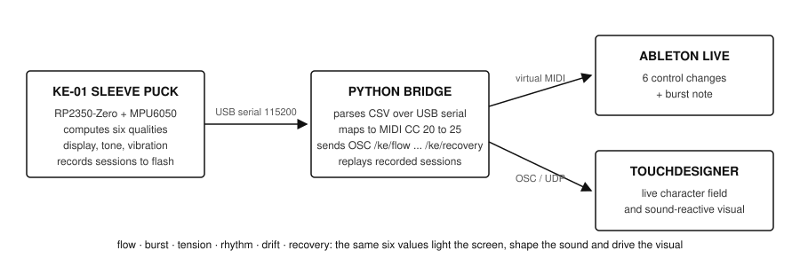

# Kinetic Echo (KE-01)

A sleeve-worn movement instrument. An IMU on the forearm reads six qualities of movement (flow, burst, tension, rhythm, drift, recovery) and turns them into a character field on a round display, a tone, a vibration, and MIDI for Ableton Live or a TouchDesigner visual.

**Status (Nov 2026):** working prototype on breadboard (display, IMU, vibration, sound). Moving from Raspberry Pi Pico 2 W to a Waveshare RP2350-Zero inside a 3D-printed puck that seats in a sewn sleeve bezel. First carrier PCB was fabricated but not populated; a round carrier is being redesigned.



_Breadboard photo to follow._

## How it works

```
KE-01 device  --USB serial 115200-->  Python bridge  --virtual MIDI-->  Ableton Live
(reads motion,                        (parses CSV,                     (6 control changes
 computes six qualities)               maps to MIDI / OSC)              + burst note)
```

The same six values light the display and shape the sound.

## Hardware

| Part | Model | Notes |
|---|---|---|
| MCU | Waveshare RP2350-Zero (was Raspberry Pi Pico 2 W) | castellated, fits behind the display |
| Display | GC9A01 1.28 in round LCD, SPI | 240 x 240 |
| IMU | MPU6050, I2C | accelerometer + gyro |
| Buttons | 3 x tactile, active low, external 10k pull-ups | RP2350-E9 erratum |
| Sound | piezo on GP7 | |
| Haptics | vibration motor on GP8 | via transistor |
| Power | 3.7 V LiPo, USB-C charger module, slide switch | |

Pin map: see [docs/pinmap.md](docs/pinmap.md).

## Repository layout

```
firmware/kinetic_echo/   Arduino sketch for the RP2350
bridge/                  Python: serial -> MIDI / OSC (device_to_ableton.py)
calibration/             scripts that derive the six movement qualities from raw IMU data
hardware/carrier-pcb/    EasyEDA / Gerber files for the carrier board
enclosure/               puck.scad, parametric OpenSCAD puck shell and lid
docs/                    pin map, build notes, images
```

## Build and run

1. Arduino IDE with the Raspberry Pi RP2040/RP2350 core (earlephilhower). Board: Waveshare RP2350-Zero.
2. Libraries: TFT_eSPI (or Adafruit GC9A01A), MPU6050 (electroniccats or Adafruit).
3. Flash `firmware/kinetic_echo/kinetic_echo.ino`.
4. `pip install -r bridge/requirements.txt`, then `python bridge/device_to_ableton.py --port /dev/tty.usbmodemXXXX`.
5. In Ableton, enable the virtual MIDI port "Kinetic Echo" and map CC 20 to 25.

## The six qualities

| Quality | What it measures | Source |
|---|---|---|
| flow | smoothness of velocity over a window | gyro |
| burst | peak acceleration above threshold | accel |
| tension | sustained low-amplitude, high-frequency motion | accel + gyro |
| rhythm | periodicity of motion | autocorrelation |
| drift | slow change in orientation | gyro integration |
| recovery | time to return to rest after a burst | accel |

Calibration notes and example data: `calibration/`.

## Roadmap

- [ ] Bring-up on RP2350-Zero, final pin map (Nov 2026)
- [ ] Hand-wired puck on round perfboard, 3D-printed shell, sleeve bezel (Dec 2026)
- [ ] Record / replay mode: capture a session to flash, play it back when the puck is docked (Jan 2027)
- [ ] OSC output for TouchDesigner (Nov 2026)
- [ ] Round carrier PCB, JLCPCB assembly (optional)

## Author

Maria Tabanelli, London. [mariatabanelli.com](https://mariatabanelli.com)

## Licence

Hardware: CERN-OHL-P v2. Firmware and software: MIT. See LICENSE.
