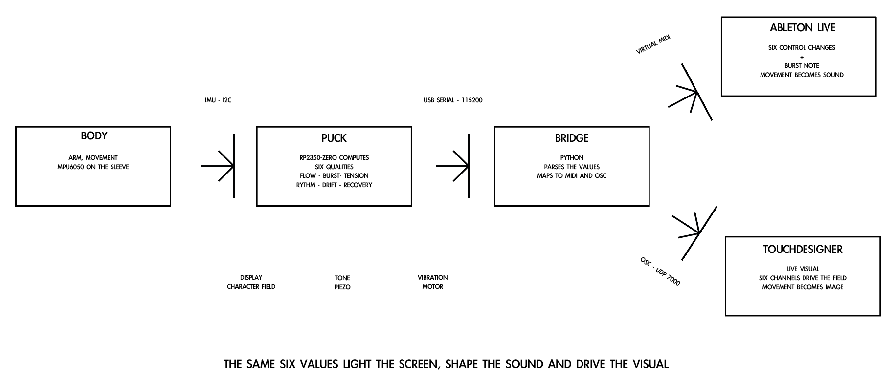
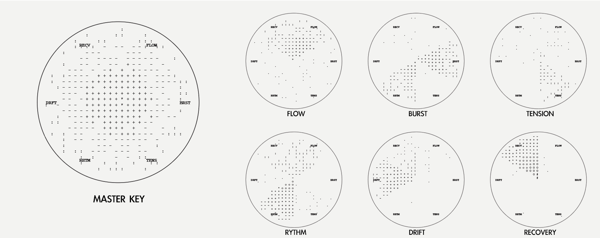

# Kinetic Echo (KE-01)

A sleeve-worn movement instrument. An IMU on the forearm reads six qualities of movement (flow, burst, tension, rhythm, drift, recovery) and turns them into a character field on a round display, a tone, a vibration, and MIDI for Ableton Live or a TouchDesigner visual.

**Status (Nov 2026):** working prototype on breadboard (display, IMU, vibration, sound). Moving from Raspberry Pi Pico 2 W to a Waveshare RP2350-Zero inside a 3D-printed puck that seats in a sewn sleeve bezel. First carrier PCB was fabricated but not populated; a round carrier is being redesigned.



_Breadboard photo to follow._

## The display



Master key and the six states. The round display is divided into six wedges, one per quality; the character field is densest at the centre and in the wedge whose value is highest.

## How it works

```
KE-01 device  --USB serial 115200-->  Python bridge  --virtual MIDI-->  Ableton Live
(reads motion,                        (parses CSV,                     (6 control changes
 computes six qualities)               maps to MIDI / OSC)              + burst note)
```

The same six values light the display and shape the sound.

## Hardware

| Part | Model | Notes |
|---|---|---|
| MCU | Waveshare RP2350-Zero (was Raspberry Pi Pico 2 W) | castellated, fits behind the display |
| Display | GC9A01 1.28 in round LCD, SPI | 240 x 240 |
| IMU | MPU6050, I2C | accelerometer + gyro |
| Buttons | 3 x tactile, active low, INPUT_PULLUP in firmware; add external 10k pull-ups on the Zero | GP2, GP3, GP6 |
| Sound | piezo on GP7 | |
| Haptics | vibration motor on GP8 | via transistor |
| Power | 3.7 V LiPo, USB-C charger module, slide switch | |

Pin map: see [docs/pinmap.md](docs/pinmap.md).

## Repository layout

```
firmware/kinetic_echo_ascii/   Arduino sketch: IMU read, six-quality pipeline, character field, buttons, buzzer, motor, CSV out
bridge/                  device_to_ableton.py (serial -> virtual MIDI for Ableton), ke_osc_bridge.py (serial -> OSC for TouchDesigner, with --sim)
calibration/             scripts that derive the six movement qualities from raw IMU data
hardware/carrier-pcb/    EasyEDA / Gerber files for the carrier board
enclosure/               puck.scad, parametric OpenSCAD puck shell and lid
docs/                    pin map, build notes, images
```

## Build and run

1. Arduino IDE with the Raspberry Pi RP2040/RP2350 core (Earle Philhower). Board: Raspberry Pi Pico 2 today, Waveshare RP2350-Zero for the puck.
2. Library: Arduino_GFX (moononournation). The MPU6050 is read directly over Wire, no library.
3. Flash `firmware/kinetic_echo_ascii/kinetic_echo_ascii.ino`. The device prints one CSV line per frame: flow, burst, tension, rhythm, drift, recovery, each 0 to 1.
4. `pip install -r bridge/requirements.txt`.
5. Ableton: `python bridge/device_to_ableton.py /dev/cu.usbmodemXXXX`. It opens a virtual MIDI port "Kinetic Echo" and sends CC 20 to 25 (the six qualities), CC 26 (intensity) and note 60 on a burst.
6. TouchDesigner: `python bridge/ke_osc_bridge.py --port /dev/cu.usbmodemXXXX` sends OSC on UDP 7000; see `docs/touchdesigner-setup.md`. Use `--sim` with no device.

## The six qualities

| Quality | What it measures | Source |
|---|---|---|
| flow | sustained mean dynamic acceleration with low jerk and low variance | accel, 64-sample window |
| burst | variance of acceleration times smoothed jerk | accel |
| tension | high peak with sustained mean and low jerk | accel |
| rhythm | regularity of intervals between peaks (coefficient of variation), gated by mean level | accel peak timing |
| drift | smoothed gyro magnitude when acceleration peaks are low | gyro |
| recovery | one minus the largest of mean, gyro and variance: how close to rest | accel + gyro |

Each raw value is smoothed with its own rate (burst fastest). Button A holds the current six values on screen, button B releases, button C replays the held signature as a buzzer and motor pulse whose length scales with burst, tension and flow.

Calibration notes and example data: `calibration/`.

## Roadmap

- [ ] Bring-up on RP2350-Zero, final pin map (Nov 2026)
- [ ] Hand-wired puck on round perfboard, 3D-printed shell, sleeve bezel (Dec 2026)
- [ ] Record / replay mode: capture a session to flash, play it back when the puck is docked (Jan 2027)
- [ ] OSC output for TouchDesigner (Nov 2026)
- [ ] Round carrier PCB, JLCPCB assembly (optional)

## Author

Maria Tabanelli, London. [mariatabanelli.com](https://mariatabanelli.com)

## Licence

Hardware: CERN-OHL-P v2. Firmware and software: MIT. See LICENSE.
